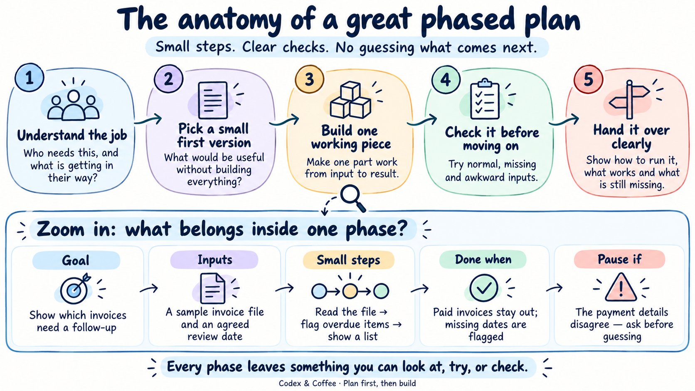

# Day 4 — Planning What to Build

**[Download everything](https://github.com/promptadvisers/codexandcoffee/releases/latest/download/day-04.zip)** · **[Start here](START-HERE.md)** · **[Download the editable board](https://github.com/promptadvisers/codexandcoffee/raw/refs/heads/main/day-04/Day-04.excalidraw)**

Eight different business ideas, with conversational prompts and notes explaining the important lines. Pick whichever is closest to your work. You do not need an earlier lesson.

## What could we build?

- [Client intake desk](examples/01-client-intake/) — spot missing details and draft the next questions
- [Newsletter workbench](examples/02-newsletter/) — turn source notes into a draft you can edit
- [Service visit planner](examples/03-service-visits/) — see the job, access details and what to bring
- [Invoice follow-up desk](examples/04-invoice-followup/) — find overdue invoices and prepare reminders
- [Stock reorder board](examples/05-stock-reorder/) — see low stock and review a draft reorder list
- [New-starter hub](examples/06-new-starter/) — find first-week tasks and answers in a company guide
- [Support reply workbench](examples/07-support-replies/) — draft replies supported by help articles
- [Site inspection report builder](examples/08-inspection-report/) — turn field notes into an editable report

Each folder has a copyable prompt and small fictional input files. These are planning exercises, not finished applications. The board includes one overview, eight annotated examples and the opening illustration.

The Day 4 package contains the board, prompts, sample files and images. A matching PowerPoint is not included.
