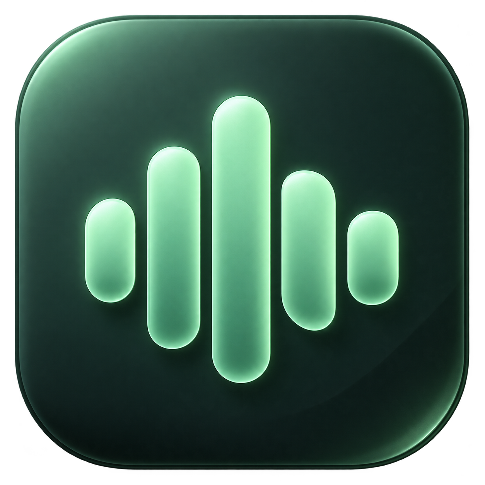

# Relay Voice



Hold a shortcut, speak, then release to turn your words into text.

This is the green Relay Voice app shared in Codex & Coffee. The Mac version builds on the original combined dictation and research app. The Windows version adds a native Windows microphone and text-insertion helper.

## Download and install

- [Mac DMG for Apple Silicon](https://github.com/promptadvisers/codexandcoffee/releases/download/day-13-relay-voice-v0.11.0/Relay-Voice-macOS-Apple-Silicon.dmg)
- [Windows ZIP for Intel and AMD 64-bit PCs](https://github.com/promptadvisers/codexandcoffee/releases/download/day-13-relay-voice-v0.11.0/Relay-Voice-Windows-x64.zip)
- [Source ZIP](https://github.com/promptadvisers/codexandcoffee/releases/download/day-13-relay-voice-v0.11.0/Relay-Voice-Source.zip)
- [Release and verification notes](https://github.com/promptadvisers/codexandcoffee/releases/tag/day-13-relay-voice-v0.11.0)

**Mac** — Open the DMG, drag Relay Voice into Applications, eject the disk, then launch Relay Voice. This download is for Apple Silicon Macs running macOS 13 or later.

**Windows** — Extract the entire ZIP to a folder you want to keep. Open `Relay Voice.exe` from that folder. Keep the included files together. Requires Windows 10 or 11, x64.

The downloads include Electron, Python and their native helper. You can install them without developer tools. These preview builds have no commercial signing certificate or Apple notarization. If your operating system blocks a download, use its normal approval controls only after checking the release source and checksum. On Mac, the approval appears in System Settings → Privacy & Security after a launch attempt. On Windows, SmartScreen may offer More info → Run anyway. Managed computers may require your administrator.

## Set up your own key

1. Create a Gemini API key in [Google AI Studio](https://aistudio.google.com/api-keys).
2. Open Relay Voice → Settings & setup.
3. Paste your key in the Gemini field and click **Save provider keys**.
4. Allow microphone access. On Mac, also allow Accessibility and, if prompted, Input Monitoring.
5. Focus an empty text field and hold **Option on Mac**, or **Ctrl+Shift+Space on Windows**.
6. Say “This is my first Relay Voice test,” then release the keys.
7. Confirm the words appear in the intended field. If an editor blocks insertion, use Copy.

Your key is encrypted with your operating-system account. The app starts with empty history and uses its own `Relay Voice Community` data folder. Blank key fields keep the keys you already saved. To remove saved keys, quit the app and delete `providers.json` from that folder.

Speech and relevant request context go to Gemini. Provider charges and quotas depend on your account. The default model is `gemini-3.5-flash-lite`. This app uses a Gemini API key independently of your Codex subscription.

## What you can do

- Dictate into ordinary text fields using the hold-to-speak shortcut
- Press Escape to cancel before insertion begins
- Ask a question in **Ask Relay**
- Add your own Firecrawl key in Settings to enable web search and research
- Open source links from research results
- Review or clear your local history
- Move or minimize the green voice bar

Windows uses guarded clipboard paste into fields that expose a writable text value. Some custom editors, elevated apps and secure fields need manual Copy. The app shows whether insertion was verified.

Gmail is an advanced optional integration. It requires your own Google Workspace CLI installation and login. The default CLI profile maps to **Primary**. **Work** and **Personal** use separate profile folders documented in [configuration](docs/CONFIGURATION.md). The desktop app can read requested email context and show a reply preview. Sending and saving email drafts are outside its desktop controls.

## Build the source

Use Node.js 24, Python 3.12 and the pinned packages below. Mac builds also need Xcode Command Line Tools. Windows builds need the .NET 10 SDK. Dependencies are installed locally to the project or virtual environment.

```sh
python3 -m venv .venv
# Activate .venv using the command for your shell
python -m pip install pyinstaller==6.22.3 certifi==2026.10.23
npm --prefix app/electron ci
python scripts/build-backend.py
```

On Mac, run `npm --prefix app/electron run package`. The app appears at `app/dist/electron/Relay Voice.app`.

On Windows, first run this command, then run `npm --prefix app/electron run package`.

```sh
dotnet publish app/windows/RelayHelper.csproj -c Release -r win-x64 --self-contained true -p:PublishSingleFile=true -p:IncludeNativeLibrariesForSelfExtract=true -o app/dist/windows-helper
```

The Windows folder appears at `app/dist/electron/Relay-Voice-Windows-x64`.

## Checks and privacy

See [verification](docs/VERIFICATION.md), [privacy](docs/PRIVACY.md), and [third-party notices](THIRD-PARTY-NOTICES.md). The release notes distinguish automated checks from hands-on microphone and destination-editor checks.

The source includes the [phased build prompt](prompts/BUILD-WITH-PHASES.md) and a [historical comparison prompt](prompts/COMPARISON-PROMPT.md). These describe the original development exercise. The current release adds cross-platform packaging and private first-run setup.

MIT license for project code. Provider services and third-party dependencies retain their own terms.
